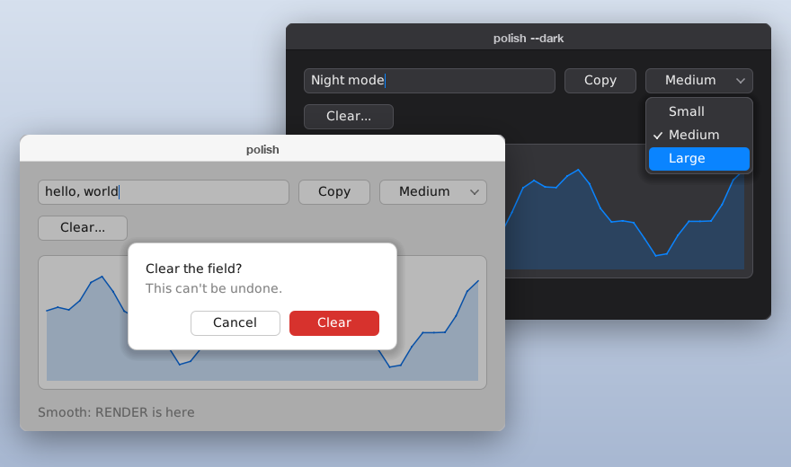
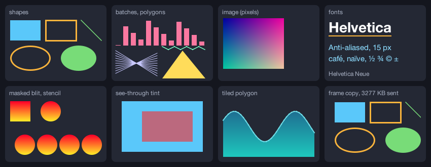

# x11-direct

A Claude Code skill and a Rust library for small X11 apps with **no
dependencies**. One file, `src/lib.rs`, speaks the X11 protocol directly
over a socket, with no Xlib, xcb or x11rb. It gives you a window, drawing
done on the server (shapes, text, canvases, masks), and key, mouse,
resize, close and paste events. With the RENDER extension (Xorg, Xvfb,
XQuartz) it also draws anti-aliased TrueType text, smooth shapes,
translucency and full-colour cursors, and it has the clipboard.



The drawing happens on the X server, and the program sends small
requests, so an app stays fast over a slow network. That makes it a good
fit for showing a window on a desktop (Linux, or XQuartz on a Mac) from
an embedded board, a container or a remote machine. The design comes
from `x11.h` in
[rp2350-native-linux](https://github.com/jvanderberg/rp2350-native-linux),
which runs a system monitor, a file manager, a terminal and Wolfenstein 3D
from an RP2350 board over Wi-Fi.

## As a Claude Code skill

```sh
git clone https://github.com/jvanderberg/x11-direct ~/.claude/skills/x11-direct
```

Claude then uses it when you ask for a lightweight X11 app. `SKILL.md`
covers the library, the cost model, and the patterns that keep traffic
small (`reference/patterns.md`). `tools/x11shot.sh` runs an app on a
headless X server in Docker and saves screenshots, so Claude can check
what an app draws.

## As a library

Copy `src/lib.rs` into your project as `src/x11.rs` and add `mod x11;`, or
depend on it:

```toml
[dependencies]
x11-direct = { git = "https://github.com/jvanderberg/x11-direct" }
```

```rust
use x11_direct::{key, Event, X11};

fn main() {
    let mut x = X11::open(None).unwrap_or_else(|e| { eprintln!("{e}"); std::process::exit(1) });
    x.window("hello", 320, 200);
    loop {
        while let Some(e) = x.event() {
            match e {
                Event::Close => return,
                Event::KeyDown { key, .. } if key == key::ESCAPE => return,
                _ => {}
            }
        }
        let (w, h) = (x.width(), x.height());
        x.color(x.rgb(0, 0, 80));
        x.fill_rect(0, 0, w, h);
        x.color(x.rgb(255, 255, 255));
        x.text(10, 20, "hello");
        x.present();
        x.wait(-1);
    }
}
```

## Examples

`DISPLAY=... cargo run --example NAME`:

| Example | Shows |
|---|---|
| `hello` | The smallest program: draw, resize, quit |
| `xeyes` | Eyes that follow the pointer, drawing only on change |
| `graph` | A live graph that scrolls on the server for about 400 bytes an update, fonts, relayout after a resize |
| `menu` | A list that redraws only changed rows and scrolls by copying, a right-click menu that restores what it covered, stdin read alongside X |
| `gallery` | Every drawing feature, with frames paced by fences |
| `polish` | A form that looks current (the picture above): TrueType text, rounded buttons, a dropdown with a shadow, a dimmed confirm dialog, hover cursors, the clipboard, a smooth graph, dark mode (`--dark`, Ctrl+D), and plain fallbacks without RENDER |

`gallery` draws every core feature, the way it looks with no RENDER at all:



## Running

`DISPLAY` names the X server: `:0` for a local one, or `HOST:0` for one
across the network. The library sends the display's cookie from
`~/.Xauthority`, so `ssh -Y host app` works (`-X` works too, but an
untrusted client gets no RENDER, so text and shapes are plain).
Otherwise, on the machine with the screen, run `xhost +CLIENT-ADDRESS` (or
`xhost +local:`). With XQuartz, first turn on Settings > Security >
"Allow connections from network clients".

Without a display: `tools/x11shot.sh -e gallery -o shots/gallery.png`
(this needs Docker).

## Limits

One window, the core protocol plus RENDER. Outline fonts cover Latin-1
(TrueType glyf outlines, no hinting or kerning), the clipboard is text
only, and there are no input methods. It needs a TrueColor display. `reference/protocol.md` explains how to add
requests. For the full protocol, use [x11rb](https://crates.io/crates/x11rb).

## License

MIT
